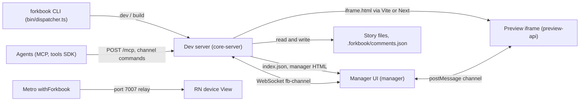

Forkbook is one npm package, `@aussieljk/forkbook`, that runs as a local dev server for web projects and as a Metro plug-in for React Native. The manager UI and the preview iframe talk through a browser channel. The server joins the same channel over a WebSocket. Agents reach the server through MCP or the `forkbook tools` SDK.

Web paths are in `code/core/src/core-server/dev-server.ts`; React Native paths are in `code/core/src/react-native/metro/withForkbook.ts`.
