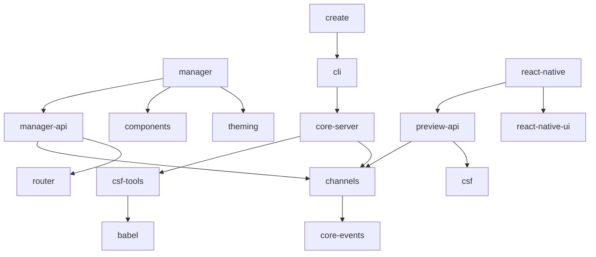

All code is in one package, so the "packages" that matter are the folders in `code/core/src/`. Each folder is a subpath export (159 in total). Counts below are imports of `@aussieljk/forkbook/<area>`; relative imports are not counted.

### Enforced rules
- `scripts/import-cycles.test.ts:13`: core-server must not import cli; csf-tools must not import core-server; node-logger must not import common; core-events must not import preview-api.
- `code/.oxlintrc.json`: no `core-server` imports inside `cli/skills/content/**`; no root imports of `@base-ui/react` or `es-toolkit`.
- `scripts/manager-layout.test.ts` builds a fixture and checks the manager layout in Chromium.
