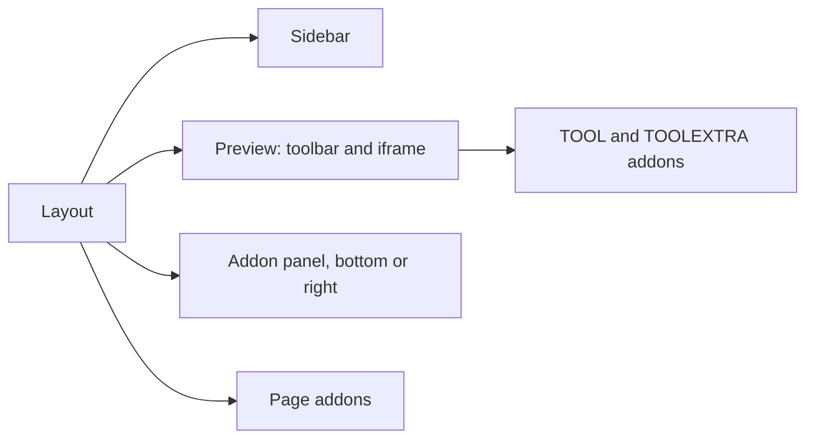

Paths are relative to `code/core/src`. `manager/App.tsx` renders `Layout` with five slots: main preview, sidebar, addon panel, pages and a review overlay. Below 600 px (`manager/constants.ts:1`) it switches to `MobileNavigation` with drawers.

There are no Canvas/Docs tabs: addon types are `PANEL`, `TOOL`, `TOOLEXTRA`, `PREVIEW`, `experimental_PAGE`, `experimental_TEST_PROVIDER` (`types/modules/addons.ts:449`).

### manager-api modules (`manager-api/root.tsx:53`)
| Module | Holds |
|---|---|
| `stories*.ts` | `storyId`, `viewMode`, `index`, filters, `updateStoryArgs`, `fetchIndex` |
| `layout.ts` | `navSize`, panel sizes, `panelPosition`, `showNav`, `showPanel`, theme |
| `globals.ts` | `globals`, `globalTypes`, `updateGlobals` |
| `addons.ts` | `selectedPanel`, addon state |
| `url.ts` | query params, `args` in URL |
| `shortcuts.ts` | 23 shortcut keys |
| `refs.ts`, `versions.ts`, `whatsnew.tsx`, `notifications.ts`, `settings.ts` | composed refs, versions, news, toasts, last story |

State is saved with store2 under `@aussieljk/forkbook/manager/store` (`manager-api/store.ts`), mostly per session. There is no undo, history or offline logic.
