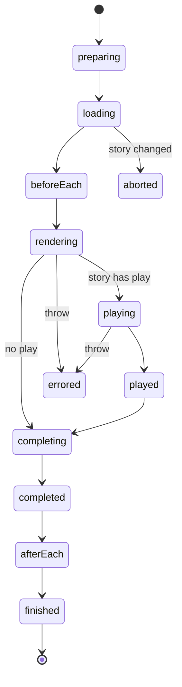

Paths are relative to `code/core/src/preview-api/modules`. `Preview` (`preview-web/Preview.tsx:210`) fetches `index.json` and builds the `StoryStore` (`store/StoryStore.ts`), which memoizes `processCSFFile` and `prepareStory`. `prepareStory` (`store/csf/prepareStory.ts`) applies loaders, `beforeEach`, decorators via hooks, the play function and `mount`.

Each `StoryRender` (`preview-web/render/StoryRender.ts:37`) emits `STORY_RENDER_PHASE_CHANGED` on every phase change.

- Emits `STORY_RENDERED` (line 403) and `STORY_FINISHED` (421).
- Docs: `render/CsfDocsRender.ts` and `render/MdxDocsRender.ts` emit `DOCS_RENDERED`; blocks are in `addon-docs/blocks/blocks/`.
- Args: `onUpdateArgs` updates `ArgsStore` then emits `STORY_ARGS_UPDATED` (`Preview.tsx:357`). Globals: `onUpdateGlobals` emits `GLOBALS_UPDATED` (317).
- `setupStoryFreezer.ts` implements `freeze=finished`; `emitTransformCode.ts` emits `SNIPPET_RENDERED`.
