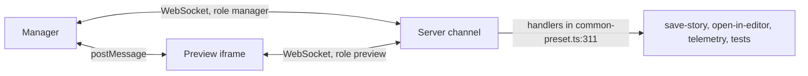

Paths are relative to `code/core/src`. `createBrowserChannel` (`channels/index.ts`) always adds a `PostMessageTransport`. In dev it also adds a `WebsocketTransport` to `<basePath>/fb-channel?token=...&page=manager|preview` (`channels/base-path.ts:16`).

- 64 events in `core-events/index.ts` (for example `SET_INDEX` :17, `SET_CURRENT_STORY` :19, `UPDATE_STORY_ARGS` :49, `STORY_ARGS_UPDATED` :51, `SAVE_STORY_REQUEST` :87).
- `core-server/utils/event-senders.ts` lists who may send each event; the server drops events from the wrong role.
- Heartbeat 15 s (`channels/websocket/index.ts:49`). Reconnect backs off and re-reads `wsToken` from the page.
- On disconnect `manager/runtime.tsx:67` shows "Reconnecting"; on `CHANNEL_WS_RECONNECT` it calls `api.fetchIndex()`.
- The server emits `STORY_INDEX_INVALIDATED` (100 ms debounce, `core-server/utils/index-json.ts:41`); the manager re-fetches `index.json` (`manager-api/modules/stories.ts:475`).
- Open Service (`shared/open-service/`) runs a second sync and command protocol (`SERVICE_SYNC_*`, `SERVICE_COMMAND_*`) on the same channel; the manager uses `useServiceQuery` and `useServiceCommand`.
