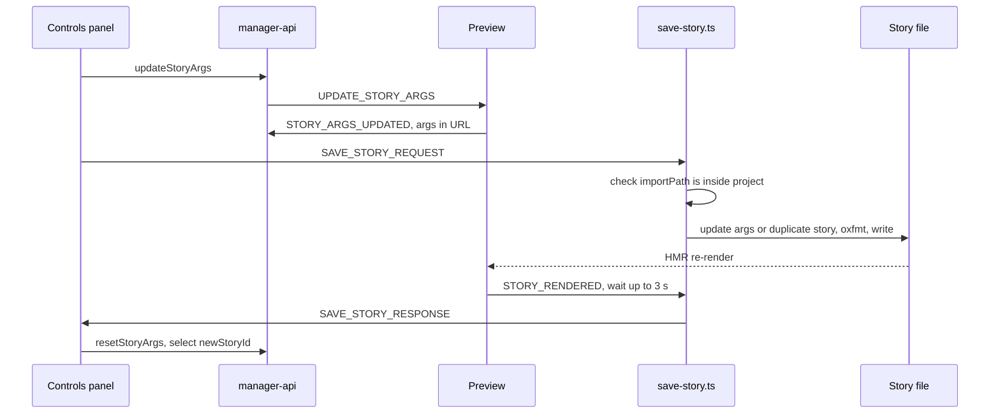

Paths are relative to `code/core/src`. Controls edit args live; "save" writes them back into the CSF file. `saveStory` sends only args that differ from `initialArgs`; `createStory(name)` sends all args and a new name (`controls/manager.tsx:48`, `:101`).

Server helpers: `core-server/utils/save-story/update-args-in-csf-file.ts`, `duplicate-story-with-new-name.ts`, `valueToAST.ts`, `getDiff.ts`; registered at `core-server/presets/common-preset.ts:316`. There is no create-new-story-file flow.
