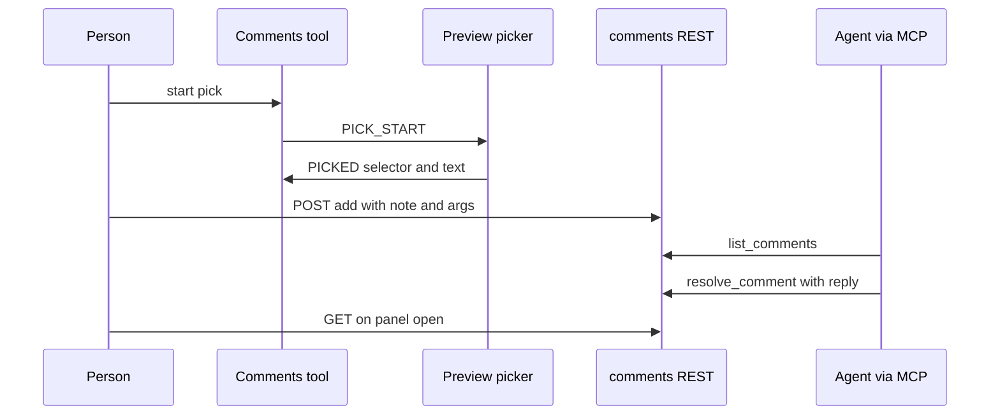

Paths are relative to `code/core/src`. Both features hand work between a person in the manager and a coding agent.

### Comments

- REST: GET/POST `/__forkbook/comments` (`addon-comments/preset.ts:97`); actions add, resolve, reopen, delete.
- `store.ts` writes `.forkbook/comments.json` through one queue with temp-file rename. MCP tools in `addon-mcp/tools/comments.ts` share it.
- `prompt.ts` writes a Claude Code prompt that tells the agent to call `resolve_comment`. The panel has no polling.

### Review
An agent calls the `review.create` tool. The `core/review` open-service stores `ReviewState {title, description, collections, changedFiles, stale}` (`shared/review/review-state.ts`), and the manager shows it at `/review/` (`manager/components/review/screens/SummaryScreen.tsx`).
