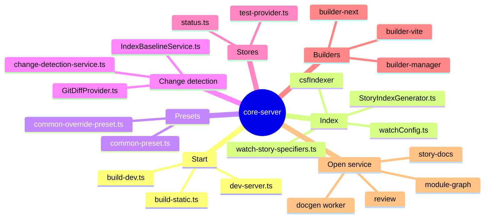

Paths are relative to `code/core/src`.

- `StoryIndexGenerator` (`core-server/utils/StoryIndexGenerator.ts:119`) indexes CSF files with `csf-tools` `loadCsf`; `invalidate` (:904) runs on watcher events from `@parcel/watcher`.
- `ComponentMetaManager` (`react/componentManifest/componentMeta/ComponentMetaManager.ts`) runs tsgo docgen in a worker thread (`shared/open-service/services/docgen/worker/docgen-worker-client.ts:55`).
- `get-builders.ts` resolves the manager and preview builders.
- The change-detection service compares git state with the index baseline and writes results to the status store.
