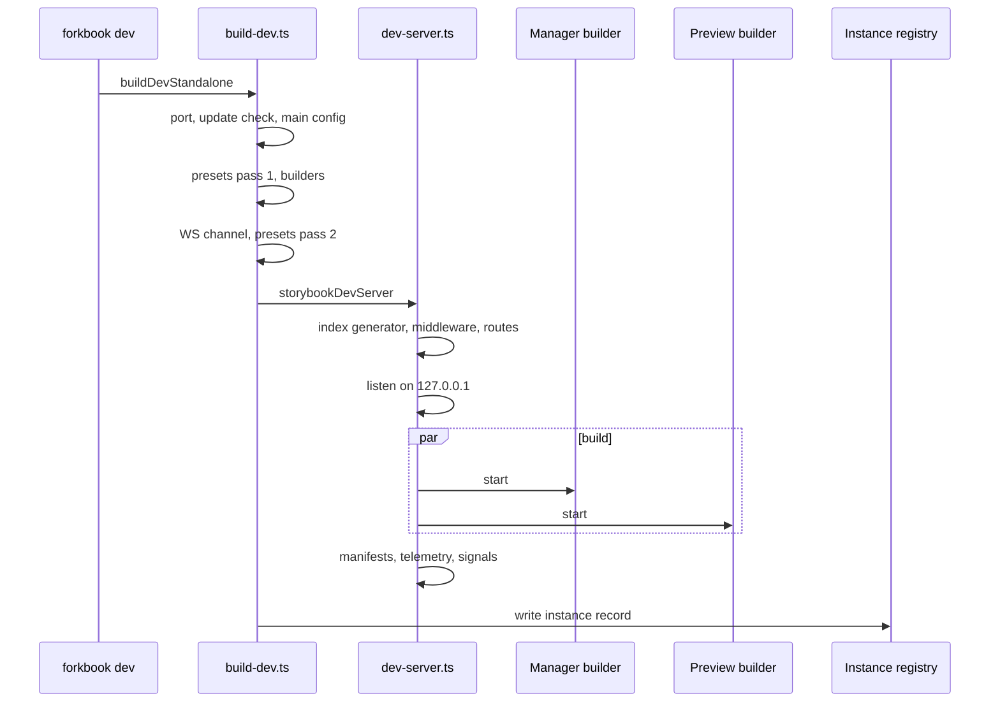

Paths are relative to `code/core/src/core-server`.

Static build (`build-static.ts:76`): clear output, presets, manager build, then in parallel copy statics, open-service JSON and manifests, `index.json`, route pages and thumbnails, preview build; then `build` telemetry.

`FORKBOOK_PARENT_PID` makes the server exit when its parent dies (2 s check, `build-dev.ts:365`).
