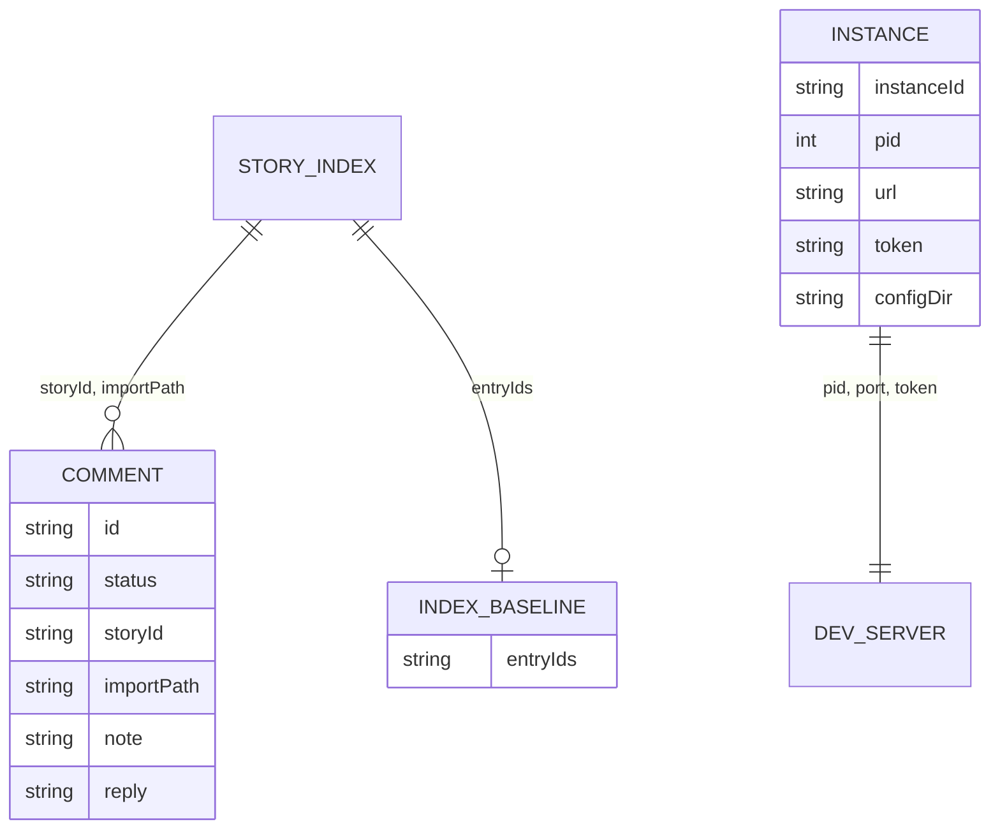

There is no database. State lives in JSON files. Paths are relative to `code/core/src`.

| File | Content | Writer |
|---|---|---|
| `.forkbook/comments.json` | `{version: 1, comments}` | `addon-comments/store.ts` |
| `~/.forkbook/instances/<id>.json` (0600) | running server, token, MCP endpoint; pruned after 1 or 7 days | `core-server/utils/runtime-instance-registry.ts` |
| `node_modules/.cache/forkbook/<v>/dev-server/` | `lastUpdateCheck`, `whats-new-cache`, `index-baseline` | `common/utils/cache.ts` |
| `.../@aussieljk-forkbook/test` | test config, 14 day TTL | `addon-vitest/node/test-run-responder.ts:64` |
| Story CSF files, `main.ts` | saved args, What's new toggle | `save-story.ts`, `whats-new.ts` |
