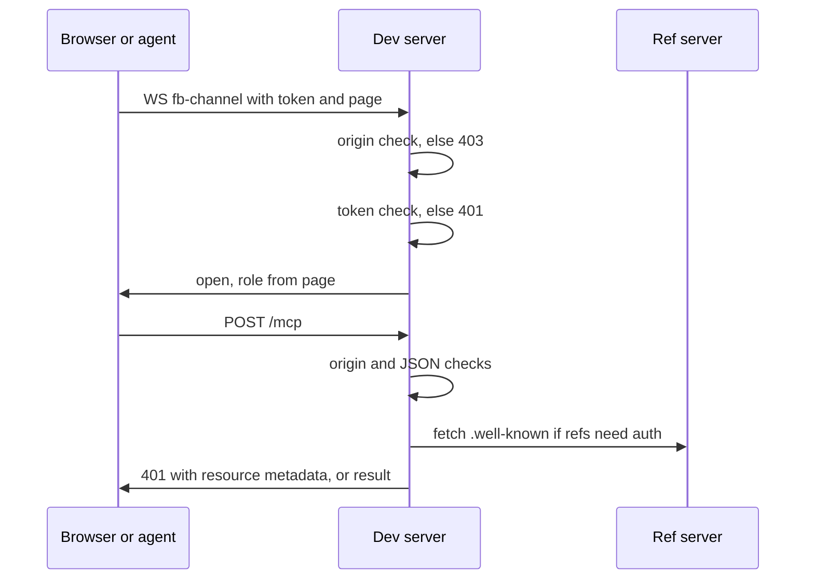

Forkbook has no user accounts. It protects a local server. Paths are relative to `code/core/src`.

| Credential | Lifetime | Checked by |
|---|---|---|
| WebSocket token (random UUID) | one server process | `core-server/utils/validate-token.ts` (constant time) |
| Same token in instance record | until record is pruned | `cli/tools/instances/registry.ts:15` |
| Bearer token for composed refs | set by the ref's OAuth server | `addon-mcp/auth/composition-auth.ts` |

- The token is in the page HTML; the browser re-reads it on reconnect.
- The comments route checks only same-site origin (`addon-comments/preset.ts`).
- Origin and DNS-rebinding checks are skipped in WebContainers.
