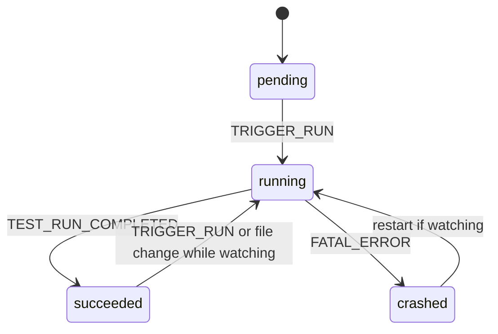

Paths are relative to `code/core/src/addon-vitest`. The manager widget, the server and a forked Vitest child share a UniversalStore (`manager-store.ts`). Events: `TRIGGER_RUN`, `CANCEL_RUN`, `TOGGLE_WATCHING`, `FATAL_ERROR`, `TEST_RUN_COMPLETED` (`types.ts`).

States are `test-provider-state:*` in `shared/test-provider-store/index.ts:11`; set at `node/test-run-responder.ts:93` and `:144`.

- `node/boot-test-runner.ts` forks `node/vitest.mjs` with `VITEST_CHILD_PROCESS=true`; boot limit 30 s. The child sends `ready`, then gets the story index and queued events.
- `node/test-manager.ts:120` runs tests in `runWithState` and flushes results every 500 ms.
- Agents start runs with `TRIGGER_TEST_RUN_REQUEST` (`node/test-run-responder.ts:200`) or the `test-run` MCP tool; a second run while one is active gets "Tests are already running".
- Coverage is served at `/coverage` in dev (`preset.ts`).
