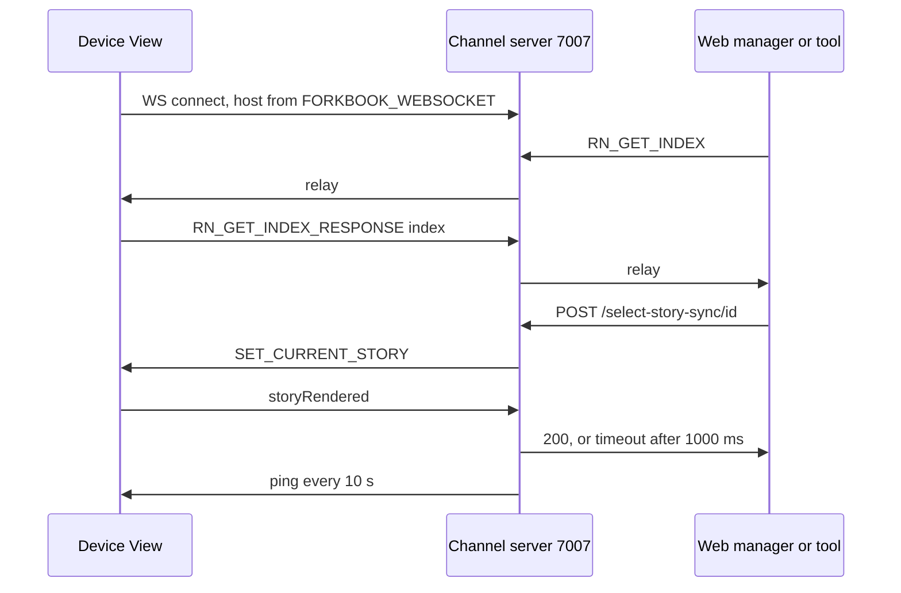

Paths are relative to `code/core/src`. The RN code is vendored from storybookjs/react-native v10.6.1 (`code/core/build-config/react-native.ts`). The channel server in Metro relays each JSON message to all other clients (`react-native/metro/channelServer.ts:191`).

- Host falls back to `10.0.2.2` on Android or `localhost`; port 7007 (`react-native/View.tsx:220`).
- Other REST: `GET /index.json` (built with `buildIndex`), `POST /send-event`.
- `start()` (`react-native/Start.tsx`) turns `require.context` keys into a `StoryIndex` and runs `ReactNativePreview`; web-only features (measure, outline, viewport, highlight, backgrounds) are off.
- On-device Controls send `UPDATE_STORY_ARGS` (`addon-ondevice-controls/hooks.ts:45`); Actions listen to `EVENT_ID`.
- UI: `react-native-ui/` (sidebar tree, search, bottom-sheet addons panel), shared parts in `react-native-ui-common/`.
