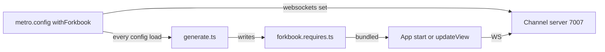

Paths are relative to `code/core/src/react-native`.

`withForkbook` (`metro/withForkbook.ts`) options: `configPath` (default `./.rnforkbook`), `websockets` (object or `'auto'`), `useJs`, `enabled`, `docTools`, `liteMode`.

- `enabled: false` resolves all Forkbook modules to empty and the config `index` to `react-native/stub` (lines 76-115).
- `liteMode` drops `react-native-ui` (line 169).
- Env overrides: `FORKBOOK_WS_HOST`, `FORKBOOK_WS_PORT`, `FORKBOOK_WS_SECURED`; `FORKBOOK_SERVER=false` stops the server (`metro/env-tools.ts`).

`generate.ts` writes one `require.context` per stories glob, imports each device addon's `register`, sets `globalThis.STORIES`, `FORKBOOK_WEBSOCKET` and `FEATURES`, and calls `start()` once or `updateView()` on hot reload (lines 195-233). `'auto'` host becomes the first LAN IPv4 address. The same step runs from `forkbook rn-stories` (`bin/get-stories.ts`).
