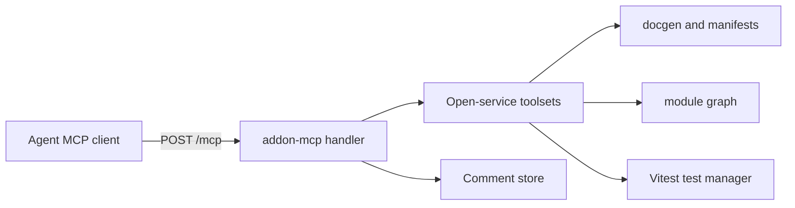

Paths are relative to `code/core/src`. `addon-mcp/mcp-handler.ts` builds a tmcp `McpServer` (Valibot, `HttpTransport`) on first request at `/mcp`. Tool names come from `toMcpToolName` = `<toolset>-<method-kebab>` (`shared/open-service/toolset-names.ts:53`).

| Group | Tools | Needs |
|---|---|---|
| stories | `stories-preview`, `stories-changed`, `stories-find-by-component` | dev server; module graph for find |
| docs | `docs-list`, `docs-show`, `docs-show-story` | manifest or docgen |
| review | `review-create` | dev server |
| test | `test-run` | addon-vitest |
| guidance | `get-forkbook-story-instructions` | none |
| comments | `list_comments`, `resolve_comment` | none |

- Resource: `ui://stories-preview/preview.html` (`addon-mcp/tools/preview-stories.ts:8`).
- `src/mcp` is a separate docs-only MCP library: `createForkbookMcpHandler` (`mcp/index.ts`) with the three docs tools; the host mounts it. `mcp/bin.ts` is an unpublished stdio harness.
