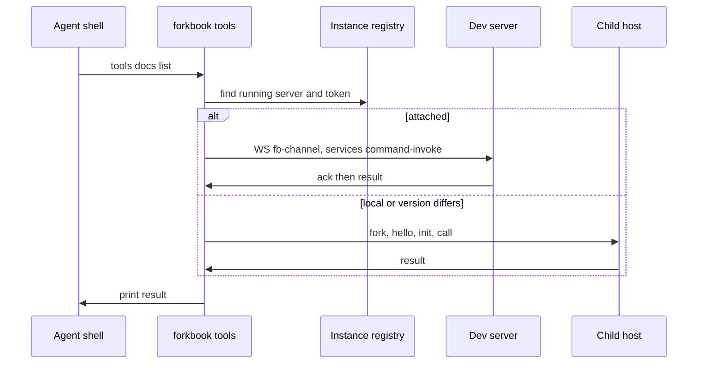

Paths are relative to `code/core/src`. `forkbook tools` and the `internal/tools` export give agents the same toolsets without MCP. `createTools({cwd, configDir, port, mode})` returns `.describe()`, `.call('docs.show', ...)` and `.close()` (`cli/tools/sdk/index.ts`).

- Child host IPC: `hello`, `init`, `describe`, `call`, `cancel`, `close`, `result`, `error` (`cli/tools/sdk/child-protocol.ts`).
- Skills: `forkbook skills <id>` prints `stories`, `write-story` or `setup` (`cli/skills/content/index.ts`).

### Long-lived helpers
| Helper | Kind | File |
|---|---|---|
| Docgen worker (tsgo) | worker thread, `init` and `extract` | `shared/open-service/services/docgen/worker/` |
| oxc parse pool | worker pool for import edges | `oxc-parser/worker-pool.ts` |
| Vitest child | forked process | `addon-vitest/node/boot-test-runner.ts` |
| RN channel server | in Metro, port 7007 | `react-native/metro/channelServer.ts` |
