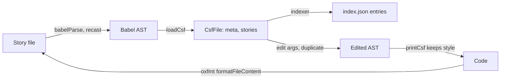

Paths are relative to `code/core/src`. A story file is Component Story Format (CSF) in one of two forms; mixing them throws `MixedFactoryError` (`csf-tools/CsfFile.ts:50`).

- Classic: `export default { component, args }` plus named story exports.
- Factories: `definePreview()` returns a `Preview`, `.meta()` returns a `Meta`, `.story()` returns a `Story`; each has a `_tag` (`csf/csf-factories.ts`).

- Parse: `babel/babelParse.ts` (recast over `@babel/parser`, TypeScript or Flow, JSX, legacy decorators); `loadCsf` at `csf-tools/CsfFile.ts:553`.
- Print: `printCsf` (recast, keeps formatting), `formatCsf` (`@babel/generator`), `writeCsf` (`CsfFile.ts:559-591`).
- `ConfigFile` edits `main.ts` and `preview.ts` with `get`, `set`, `move` (`csf-tools/README.md`).
- Formatting: `common/utils/formatter.ts` runs oxfmt with the nearest `.oxfmtrc.json`.
