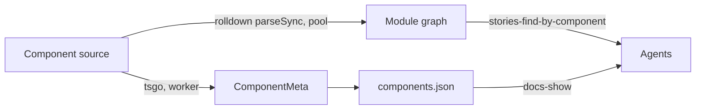

Paths are relative to `code/core/src`. Three generated JSON formats describe a project to the UI and to agents.

| Format | Shape | Served at | Built by |
|---|---|---|---|
| Story index | v5 `StoryIndex` entries (id, title, name, importPath, tags) | `/index.json` | `core-server/utils/StoryIndexGenerator.ts` |
| Components manifest | `{v, components, meta: {docgen, durationMs}}`; v1 uses shallow `$ref` | `/manifests/components.json` | `react/componentManifest/` |
| Docs manifest | MDX docs entries | `/manifests/docs.json` | `shared/open-service/toolsets/docs/access-provider.ts:39` |
| Module graph | import edges and barrel re-exports | open-service query | `shared/open-service/services/module-graph/` |

Types: `ComponentManifest` and `ComponentsManifest` at `types/modules/core-common.ts:463-515`.

- tsgo runs under Node only and reopens files when their mtime changes (`ComponentMetaManager.ts`).
- `oxc-parser/` takes `parseSync` from `rolldown/utils`; there is no separate oxc install.
- Static builds write `index.json`, `manifests/*.json` and `services/**.json` (`core-server/build-static.ts:192`).
