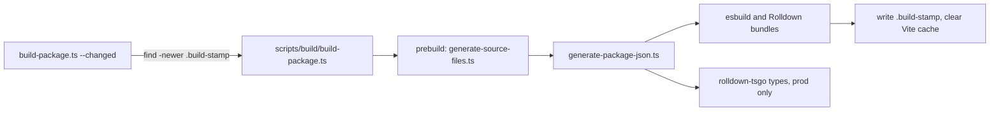

One package is built from about 20 entry lists. `code/core/build-config.ts` merges `code/core/build-config/<area>.ts` by platform: `node`, `browser`, `runtime`, `globalizedRuntime`.

- `generate-package-json.ts` writes each export as `{code, types, default}`; `code` points at the source, so typecheck needs no build.
- Bundles run in parallel with types; OTel spans wrap each step (`scripts/utils/otel.ts`).
- After a build, `node_modules/.cache/forkbook` is removed so Vite sees the new `dist`.
- `scripts/rn-device-bundle.test.ts` loads the 10 built RN entries without `document`.
