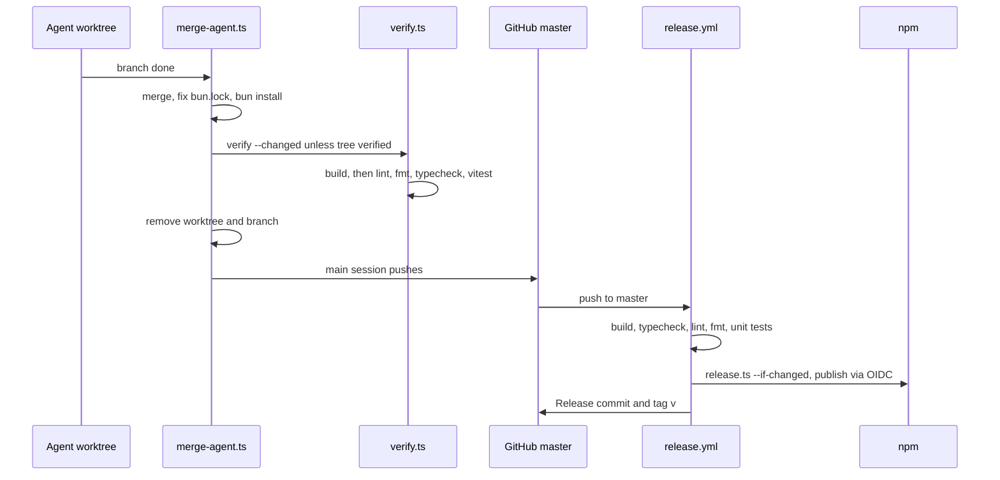

Agents work in worktrees; the main session merges and pushes `master`, and CI publishes.

`scripts/release.ts` order: skip if `code/core/` is unchanged; stop on a dirty tree; refuse `NODE_AUTH_TOKEN` in CI and need npm 11.5.1 or later; bump `X.Y.Z-N` if the version is on npm; `bun run build`; `npm publish --tag latest`; commit "Release v"; tag; push.

`verify.ts` records a passing tree hash in `VERIFIED_TREES`; logs are in `node_modules/.cache/verify`. Workflows are generated from `ci/workflows.ts` by `ci/generate.ts`.
