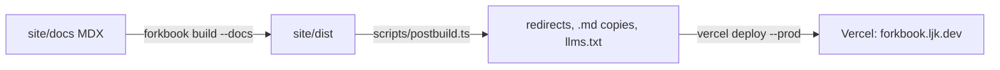

The docs site at `forkbook.ljk.dev` is a Forkbook docs-only build of the 76 MDX pages in `site/docs/`.

- Config: `site/.forkbook/main.ts` and `preview.ts`; dev on port 6020.
- `site/scripts/postbuild.ts` writes `docs/<path>/index.html` redirects, `docs/<path>.md` copies, `llms.txt` and `llms-full.txt`.
- `site/vercel.json` has 14 redirects and 8 header rules.
- The dev server fetches `versions.json` and `whats-new/v1` from this domain, but the site build makes neither; `site/vercel.json:50` redirects `/whats-new/*` to `/docs` (see Gaps).
- Deploy is manual: root `site:deploy` copies `site/.vercel` into `dist` and runs `vercel deploy`. No workflow deploys it.
